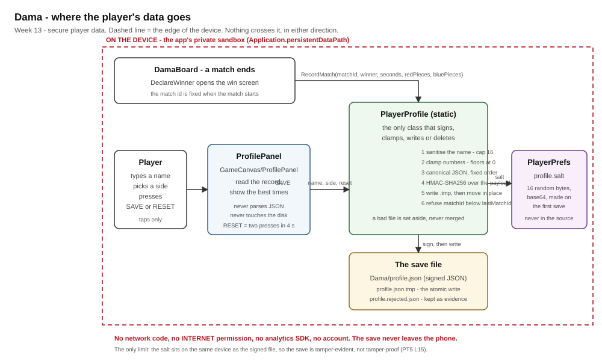

# SA5 - Theme, Player, and Advanced Game-Integration Analysis

**Game:** Dama
**Student:** Charibelle Guzman
**Section:** BSIT-4
**Course:** MOBILE DEV 002 Advanced Mobile Application Development, Module 5
**Theme:** Philippine Games and Sports
**Week:** 13 - Secure Player Data and Responsible Development
**Build:** Dama MVP (Android target: ARM64 / IL2CPP, `com.defaultcompany.dama`, minimum API 26)
**Repository:** local Git repository, branch `main`, code commit `b9a612d`
**Engine:** Unity 6000.6.0f1, Universal Render Pipeline 17.6.0 (2D Renderer)

---

## 1. Theme-to-Mechanics Justification

### Target player

A Filipino student who has played *dama* on a drawn board or on a checkerboard borrowed from
a classmate, and who now has a phone and five spare minutes between classes. They already
know how the pieces move. What they want is the specific tension of the game: the capture
that is *forced* on you whether you like it or not, and the long diagonal run of a king that
has just been crowned. They are not looking for a story, a progression grind or an opponent
to chat with. They are looking for one clean, complete contest.

### Intended experience

*Dama* is not a gentle board game. Two rules carry its character:

1. **The capture is compulsory.** If a jump exists, you must take it. A player cannot decline
   a bad capture and wait for a better one, so the game constantly forces you into positions
   you would have avoided.
2. **The king flies.** A piece that reaches the far row becomes a *Dama* and moves any
   distance along any diagonal, in any direction. A single piece can cross the whole board in
   one move.

Those two together are the experience: calculating a forced exchange several moves deep, and
dreading the moment the opponent crowns a piece. Every design decision below is judged
against one question: does this make the player feel the forced capture and the flying king
the way they feel them on a real board?

### Core gameplay loop

1. **Read the board.** The player's legal moves are highlighted; if a capture exists, only
   captures are offered, because declining is not allowed.
2. **Choose.** Tap a piece, tap a destination. A tap is the whole input - there is no drag,
   no gesture, no timing.
3. **Chain.** A capture that lands on another capture continues: the same piece keeps jumping
   until the chain ends. The chain cannot be abandoned by tapping off the board.
4. **Crown.** Reaching the back row turns the piece into a flying *Dama* with a crown stacked
   on it.
5. **Win or lose.** The match ends when a side has no pieces left, or has pieces but no legal
   move (blocked). Either condition is a loss for that side.
6. **Hand over the phone.** Two people play on one device, taking turns. This is the rule that
   shapes the rest of this document.

### How the mechanics communicate the theme

| Element of *dama* | Mechanic in the game | Why it is not decoration |
|---|---|---|
| A capture must be taken | Forced-capture filter: when any jump exists, non-capture moves are not offered at all | This single rule is what makes the game *dama* and not checkers-with-a-Filipino-skin. It is enforced in the move generator, not suggested by a hint |
| Multi-jump chains | `DamaBoard` keeps the chain alive after landing and re-highlights only the continued jumps | The chain is the game's most dramatic moment; letting the player stop halfway would remove the risk of a long chain |
| The crowned *Dama* flies | `PromoteToDama` sets a king flag, stacks a gold crown, and enables any-distance movement on all four diagonals | The crown is visible because the change in power is the point. A king that only moved one square would be a different game |
| Two people, one board, face to face | Two local players on one device, alternating turns; no network code at all | Hot-seat play is how the game is actually played. It is also why the profile needs a **side** setting, explained below |
| Playing on a board you can read at a glance | 8x8 grid, one screen, no camera movement, no scrolling | The whole board is the interface. Nothing is hidden, which is what makes it a fair contest between two people sitting together |

### The one mechanic this week adds

`PlayerProfile` gives the game a name, a win/loss record, a win streak and a local board of
the five fastest victories. In a hot-seat game a win/loss record is meaningless unless the
game knows **which side the profile's owner plays**, so the profile stores a side (RED or
BLUE) and the panel has a toggle for it. Without that one field, "you have 6 wins" would be a
sentence about a phone rather than a sentence about a player. That is why the side setting is
part of the feature and not a leftover.

---

## 2. Player and stakeholder analysis

| Stakeholder | What they need from this build | How the build answers it |
|---|---|---|
| The player | Understand the goal without reading a manual; know instantly what just happened; play with one thumb | Highlighted legal moves, forced captures filtered automatically, a crown on a promoted piece, a HUD naming whose turn it is, and a win screen that names the winner |
| The player, as the owner of their own data | Know that nothing about them leaves the phone, and be able to erase it | The game has no networking code, forces no `INTERNET` permission and makes no web request. The profile is one JSON file in the app's own sandbox, the panel says *"Nothing leaves this device"* on screen, and RESET erases it in two presses |
| The player, as someone who might lose a record | Be protected from a single accidental tap | RESET is two presses within 4 seconds; the first press renames the button to `PRESS AGAIN` and says what will be lost |
| The instructor | Verifiable evidence that the work is the student's own | A Git commit, a check log with measured values, four play-mode captures, and a disclosure record in PT5 section 9 |
| Two people sharing one phone | Not be confused about whose turn it is | A turn indicator in the HUD, and a profile side setting so the record belongs to a person, not to the device |
| Future playtesters (Week 14) | A build that behaves the same way twice | Deterministic rules, fixed camera, no random element in the rules at all - only the players' choices vary |

---

## 3. Gameplay and integration requirements

| ID | Requirement | Where it lives |
|---|---|---|
| R1 | Start a match, restart it, pause and resume, return to the start screen | `DamaBoard` state machine (`Ready` / `Playing` / `Paused` / `GameOver`) |
| R2 | Only legal moves are offered | `DamaBoard` move generation |
| R3 | A capture that exists must be taken | Forced-capture filter in the move generator |
| R4 | A capture chain continues until it ends on its own | `DamaBoard` chain handling |
| R5 | Reaching the back row crowns a flying *Dama* | `DamaBoard.PromoteToDama` |
| R6 | The match ends on no pieces or no legal move | `DamaBoard.CheckForWin` -> `DeclareWinner` |
| R7 | Two local players alternate turns on one device | `DamaBoard` turn state |
| R8 | Remember who the player is and what they have achieved, across launches | **Week 13: `PlayerProfile` (signed JSON save)** |
| R9 | Record which side the profile's owner plays, so the record is about a person | **Week 13: `PlayerProfile.PlayerSide` + `ProfilePanel.ToggleSide`** |
| R10 | Show the record and the fastest-victory board on a screen opened from the start screen | **Week 13: `ProfilePanel`, `GameCanvas/ProfilePanel`** |
| R11 | Survive a corrupt or hand-edited save without crashing or trusting it | **Week 13: HMAC signature + quarantine + clamps** |
| R12 | Bank a finished match exactly once, never twice | **Week 13: match id fixed at match start, plus the store's id gate** |

---

## 4. Data inventory

Everything the build stores, in one table. "Sandbox" means the app's own private folder,
which on Android is not readable by other apps.

| Data item | Where it comes from | Where it is stored | Who can read it | Lifetime and deletion |
|---|---|---|---|---|
| Display name (up to 16 characters) | Typed by the player on the profile panel | `profile.json` in `Application.persistentDataPath/Dama/` | The app; the device owner via a file manager | Until RESET is pressed, or the app is uninstalled |
| Preferred side (RED or BLUE) | The SIDE toggle on the profile panel | `profile.json` | The app | Same as above |
| Aggregate record (wins, losses, draws, current streak, best streak) | Derived while a finished match is banked | `profile.json` | The app | Same as above |
| Recent matches, up to 20 (match id, result, winning side, seconds, red pieces left, blue pieces left, UTC time) | Banked once at the end of a match from `DamaBoard.BankMatch` | `profile.json`, `recent` list, newest first | The app | Oldest entries dropped past 20; RESET erases all |
| Last match id, last played UTC | Written when a match is banked | `profile.json` | The app | Same as above |
| Signature salt (16 random bytes, base64) | Generated by the app on its first save | `PlayerPrefs["profile.salt"]` | The app | Survives RESET, so a reset profile is still signed the same way by this install |
| **Not collected:** account, e-mail address, phone number, contacts, location, advertising id, device identifiers, analytics, telemetry, crash reports | - | - | - | - |

The bottom row is the important half of the table. The project has no login, no multiplayer,
no analytics SDK and no web request. `Packages/manifest.json` contains no Firebase, PlayFab or
Unity Services package, the Android Player Setting `ForceInternetPermission` is off, and the
game requests no permission at all. There is nothing to transmit and nowhere to transmit it.
The scan behind that sentence is `Evidence/secrets_and_gitignore.txt`.

Note what is **not** in `PlayerPrefs`: match settings, difficulty or a cached board state. The
only key this project uses is `profile.salt`, which exists because a signature needs a key and
a key must not be in the source. Put differently, `PlayerPrefs` is not used as a save system
here - it holds one install identity value and nothing a player would care about losing.

---

## 5. Data-flow diagram

Reading the diagram: the player's two inputs (a typed name, and the RESET command) enter
through `ProfilePanel`; `PlayerProfile` is the only class that signs, writes, clamps or deletes
anything; the only other writer is the end of a match, and it goes through the same
`RecordMatch` gate that refuses a match id it has already banked. The dashed boundary at the
top right is the device: nothing crosses it, in either direction.

---

## 6. Identity model decision

The module allows no account at all, a local profile, anonymous authentication, or full
e-mail authentication, and asks the choice to be proportionate to the game. The four options
were considered as follows.

**Decision: a local profile, with no account of any kind.**

Why:

- **The game is offline and hot-seat.** Two people sitting next to each other on one device
  is the whole product. An account would exist only to identify a player to a server that has
  no role in the match.
- **A login would cost a real feature.** Sign-in on a game meant to be opened between classes
  adds failure states - no signal, forgotten password, a slow first launch - in exchange for
  nothing the two players in front of the board need.
- **It would create an obligation nothing here can service.** Collecting an e-mail address
  from students means a deletion process, a retention policy and a breach process. This
  project has none of those, so the honest move is not to collect the address.
- **It matches the build, verifiably.** No cloud package is installed and the network
  permission is not requested, so an account model would be a promise the build does not keep.

What the player gets instead: their name, their side, their record and their fastest victories
on a screen they open from the start screen, kept between launches, and erasable by them in
two presses.

The honest cost of this decision, stated rather than buried: a local record can be edited by
whoever owns the phone. The signature makes that **detectable**, not impossible. See PT5
section 5 and check L15.

---

## 7. Secure configuration and secret handling

| Risk | Position in this build | Evidence |
|---|---|---|
| Credentials in source code | There are none. No API key, token, service account file or password exists, because no service is used | `Evidence/secrets_and_gitignore.txt` (scan output) |
| A shipped secret | The only secret-like value is the signature salt, and it is **generated at runtime** into `PlayerPrefs`, never committed | `PlayerProfile.GetSaltBytes` |
| Build artefacts in the repository | `.gitignore` excludes `*.apk`, `*.aab`, `*.unitypackage`, `*.keystore`, `*.jks`, `Library/`, `Temp/`, `Builds/` | `.gitignore` |
| Player records readable by other apps | The save lives inside `Application.persistentDataPath/Dama/`, which on Android is the app's private sandbox | `PlayerProfile.DataDirectory` |
| Trusting untrusted input | The save file is treated as hostile: parsed defensively, signature-checked, clamped, and quarantined instead of overwritten | `PlayerProfile` load path, `Clamp`, quarantine move |
| The repository leaking a signing key later | The keystore rule is in `.gitignore` even though there is no keystore yet - a rule added after the fact does not remove a file already pushed | `.gitignore` |

What is **not** claimed: the save is not encrypted, and the salt sits on the same device as
the file. This is stated on screen, in PT5 and in the README rather than glossed over.

---

## 8. Failure and recovery design

An offline game has no network to fail, so the failures that matter are the disk and the file
itself.

| Failure | What the build does | Check |
|---|---|---|
| No save file at all | Starts on `PLAYER` with an empty record; nothing is written until the player saves something | L1 |
| The save file is not JSON at all | Parsing is wrapped; the file is moved to `profile.rejected.json` and a fresh profile starts. The bad file is kept as evidence | L10 |
| The save was edited by hand | HMAC mismatch; the same quarantine path. The edited values never reach the screen | L11 |
| The save holds impossible numbers but a valid signature | Clamped after the signature passes: negatives floored, `bestStreak` raised to at least `currentStreak`, name re-sanitised, recent list cleaned | L12 |
| The save folder cannot be written | The write is wrapped, `LastError` is set, and the panel prints the reason. In-memory state is rolled back so memory and disk never disagree | L14 |
| The app is killed mid-write | The file is written to `profile.json.tmp` and then moved over the old one, so a half file never replaces a whole one | design, `PlayerProfile.Save` |
| The same match is reported twice | The match id is fixed when the match starts, so `DamaBoard.BankMatch` refuses the repeat, and `RecordMatch` refuses any id at or below `lastMatchId`. Two independent guards | L9 |
| The record is wiped by an accidental tap | RESET needs two presses within 4 seconds; the first press says what will be lost | `ProfilePanel.ResetPressed` |

---

## 9. Integration plan, Weeks 13 to 18

| Week | What this profile work becomes the input for |
|---|---|
| 13 | The profile, the signed save, the panel and the fifteen security checks - this submission |
| 14 | The profile panel is one of the screens a usability test covers: is a 16-character name field with a visible limit understandable on a phone; can a player find the SIDE toggle; is the fastest-victory board legible at arm's length; is the two-press RESET discoverable without instruction |
| 15 | The bank path is a test target: each of the two end conditions (no pieces, no legal move) must bank exactly one match, and RESET must never leave a half-erased state. This is the week a defect log and a traceability matrix begin |
| 16 | Profiling: the save is a synchronous file write at the end of a match, so its cost on the end-screen frame is measured, and moved off that frame if it shows |
| 17 | The README, user guide and evidence index describe this component instead of being written from scratch |
| 18 | The profile is part of the demo script: enter a name, choose a side, win a match, show the record and the fastest-victory board, then show the two-press reset |

---

## 10. Risk register

| Risk | Likelihood | Impact | Mitigation in this build |
|---|---|---|---|
| A hand-edited save is trusted | Medium | The player's record becomes meaningless | HMAC check; rejected files quarantined, never merged (L11) |
| A corrupt save crashes the game on launch | Low | The game will not open at all | Every read and write is wrapped; a failure starts a fresh profile (L10) |
| A long record is lost by an accidental tap | Medium | Trust in the game | Two-press reset with a warning and a 4-second disarm (L13) |
| A match is banked twice, inflating the record | Medium | The record lies, which is the one thing a record must not do | Match id fixed at match start plus the store's id gate (L9) |
| Personal data is collected without a process to delete it | Very low | Data-protection exposure | No personal data is collected; the name is 16 characters, player-chosen and player-deleted |
| The profile work breaks the match flow | Medium | The submission does not run | The end of a match is the only coupling, guarded by match id and verified by playing a match to a win in play mode |
| A secret ends up in the repository later | Low | Credential exposure | No service to hold a key for; build and keystore rules in `.gitignore`; scan recorded in `Evidence/` |

---

## 11. Evidence index

| File | What it shows |
|---|---|
| `Evidence/pt5_checks.log` | Fourteen assertions with their measured values, plus L15 as a documented limit |
| `Evidence/E1_profile_empty.png` | The panel on a fresh install: `PLAYER`, 0 matches, no best times |
| `Evidence/E2_profile_stats.png` | The record after three matches: `Charibelle G.`, 3 matches, 2W / 1L, best streak 2 |
| `Evidence/E3_leaderboard.png` | The fastest-victory board with five entries, quickest first: 38.9, 42.5, 47.3, 50.0, 55.0 |
| `Evidence/E4_after_reset.png` | The panel after the two-press reset: back to `PLAYER`, record empty, *"Profile erased."* |
| `Evidence/week13_shots.log` | The timestamped record of the capture run, including the bank-once result |
| `Evidence/build_and_commit.txt` | The Android settings, the scene order, the commit id and what was not built |
| `Evidence/secrets_and_gitignore.txt` | The credential scan and the ignore rules, with the reasoning for each rule |
| `Evidence/HOW_TO_RERUN.txt` | How to reproduce every check and every screenshot |
| `others/SA5_data_flow.svg` | The data-flow diagram in section 5 |
