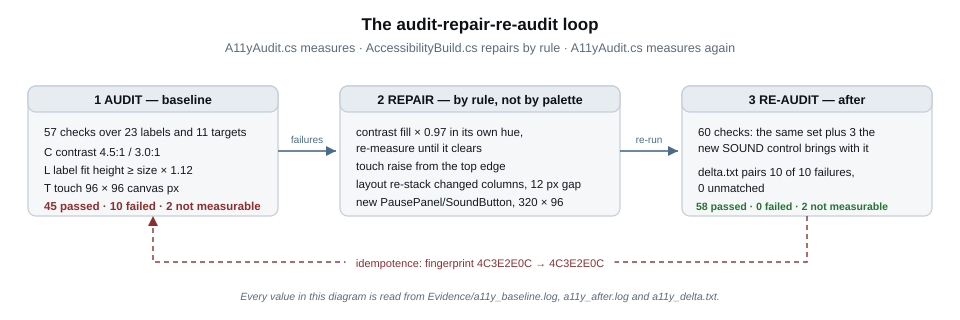

# SA6 - Usability, Accessibility and Playtest Method Analysis

**Game:** Dama
**Student:** Charibelle Guzman
**Section:** BSIT-4
**Course:** MOBILE DEV 002 Advanced Mobile Application Development, Module 5
**Theme:** Philippine Games and Sports
**Week:** 14 - Game Usability, Accessibility and Playtesting
**Build:** Dama MVP (Android target: ARM64 / IL2CPP, `com.defaultcompany.dama`, minimum API 26)
**Repository:** local Git repository, branch `main`, code commit `1998b0c`
**Engine:** Unity 6000.6.0f1, Universal Render Pipeline 17.6.0 (2D Renderer)

---

## 1. What usability means for *this* game

Dama is played by two people on one phone, and one of them is always a beginner. That is not a
marketing description of the audience - it is a structural property of a hot-seat board game. Every
match begins with a person being handed a device that is already in the middle of something, by
someone who has just been using it. There is no tutorial, no account, no first-run flow: the start
screen is the whole introduction.

Three properties of *dama* make that harder than it sounds, and each one maps onto a usability
question:

| The rule | What it demands of the interface | Why a test is the only way to answer it |
|---|---|---|
| **A capture must be taken** | The player must understand why most of their pieces are not selectable. The interface is refusing legitimate-looking moves, and it has to look deliberate rather than broken | No amount of code review says whether that refusal reads as a rule or as a bug. Only a player can |
| **A capture chains** | The same piece must keep jumping while the player is still tapping, and stopping half way must be impossible | Whether the chain feels continuous or feels like a glitch is a perception question |
| **The king flies** | A crowned piece changes power completely: one square becomes any distance, in any direction | If the crown is not legible at a glance, the player loses the game without knowing why |

The interaction the game asks for is deliberately tiny: **tap a piece, tap a destination**. There is
no drag, no gesture, no timing window, no double-tap. That choice was made in earlier weeks for
touch reliability, and Week 14 is where it is measured rather than assumed.

### The two audiences of this week

1. **A first-time player**, who has never seen the game and will not read anything. The audit
   measures what can be measured about them - can the label be read, can the control be hit - and
   the playtest measures the rest.
2. **A player with a temporary or permanent impairment**: holding the phone one-handed on a bus, a
   cracked screen, sunlight, small hands, or low vision. Accessibility work here is not a separate
   feature for a separate user. It is the same work, done for the worst plausible viewing condition
   instead of the best one.

---

## 2. The audit method

The audit is a Unity editor script, `Assets/Scripts/Editor/A11yAudit.cs`, run from
**Tools > Dama > Week 14 > 1. Run Accessibility Audit**. It walks every `Text`, `Button` and
`InputField` under `GameCanvas` - **including the panels that are switched off**, which is the
point, because a check that only looks at the visible start screen would never see the pause
button or the profile panel.

Three check codes, three thresholds:

| Code | What it measures | Threshold | Where the threshold comes from |
|---|---|---|---|
| `C` | Contrast of a label against its backdrop | 4.5:1 normal text, 3.0:1 for large text (28 px or more, or 24 px bold) | WCAG 2.2 SC 1.4.3, Level AA |
| `L` | Label box height versus type size | `rect.height >= fontSize x 1.12` | A box shorter than the type's line height clips it. Legacy uGUI `Text` with `verticalOverflow = Overflow` *spills* rather than vanishes, so the check reports `CLIPPED` (fails) and `SPILLS` (warns) separately |
| `T` | Touch target | 96 x 96 canvas px, both dimensions, every `Button` and `InputField` | Derived, below |

### Why the touch floor is 96 px and not 144

The published mobile guidance is a **48 dp** minimum touch target (Android's own figure; WCAG 2.2
asks for 24 CSS px minimum, 44 enhanced). Those are physical or CSS units, not canvas units, and
this project draws in canvas units - so the number has to be converted, and the conversion is
written into the log header rather than assumed:

```
CanvasScaler : Scale With Screen Size, reference 1280 x 720, match 0.50
On a 1080p landscape phone (1920 x 1080):  1920/1280 = 1080/720 = 1.50  -> uniform scale 1.50
Android 48 dp at xxhdpi (density 3.0)   :  48 x 3 = 144 physical px
144 physical px on a 1.50-scaled canvas :  144 / 1.50 = 96 canvas px
```

**96 canvas px is therefore this project's floor.** A flat 144 would have been a stricter number
applied to a different unit - it would have demanded controls 50 % taller than the platform
requires and forced a redesign of the whole HUD to satisfy an arithmetic mistake.

Stated in the same breath, because it matters: this is a **canvas-pixel measurement against a
reference resolution on an assumed phone class**. It is not a ruler held against a handset. The log
header says exactly that, in both runs.

### What the audit deliberately refuses to do

- **It does not invent a contrast ratio for a label with no backdrop.** `HUDPanel/TurnText` and
  `HUDPanel/CountsText` are drawn straight over the 3D board, so the backdrop changes as pieces
  move. Both runs report them as `NOT MEASURABLE` and neither run counts them as a pass.
- **It does not guess at a colour.** Contrast is composited against the nearest ancestor `Image`
  with alpha >= 0.50, over black. Black is the darkest plausible backdrop, which is the *most
  favourable* case for white text and therefore the least flattering place to be lenient.
- **It does not claim an accessible game.** Its own closing line: *"an accessible game, and it
  cannot read a label that is the right size and still says nothing."*

---

## 3. Baseline - what the build looked like before any fix

`Evidence/a11y_baseline.log`, 2026-11-26 03:56:56 UTC:

```
TOTAL: 45 passed, 10 failed, 0 warnings, 2 not measurable
```

Fifty-seven checks in total: 23 labels x 2 (contrast + fit) = 46, plus 11 touch targets, of which
two label checks were not measurable. Ten of them failed.

### The three contrast failures

| Control | Ratio | Need | Fill | Why it failed |
|---|---|---|---|---|
| `PausePanel/ResumeButton/Text` | 4.27:1 | 4.5:1 | `#268C40` | A green chosen to *look* like "go". Close, but 0.23 short - the kind of miss nobody sees until it is measured |
| `PausePanel/RestartButtonPause/Text` | 2.72:1 | 4.5:1 | `#D98C1A` | An amber chosen to look like "careful". The worst ratio in the build - white on mid-amber is nearly 40 % short |
| `WinPanel/RestartButtonWin/Text` | 2.72:1 | 4.5:1 | `#D98C1A` | The same fill, reused on the end screen, failing the same way |

All five button captions are 14 px, so all three fail against the **4.5:1 normal-text** bar, not the
3.0:1 large-text bar. That single fact is why the fix had to darken the fills rather than argue that
the text was large.

### The seven touch failures

| Control | Size | Short by | What it is |
|---|---|---|---|
| `StartPanel/ProfileButton` | 320 x 84 | 12 px | The entry point to the Week 13 profile |
| `HUDPanel/PauseButton` | 170 x 64 | 32 px | The only control during a match |
| `ProfilePanel/SideButton` | 260 x 52 | 44 px | The RED / BLUE toggle |
| `ProfilePanel/SaveButton` | 200 x 54 | 42 px | Writes the profile |
| `ProfilePanel/ResetButton` | 200 x 54 | 42 px | Erases the profile |
| `ProfilePanel/BackButton` | 200 x 46 | 50 px | The only way out of the panel |
| `ProfilePanel/NameInput` | 420 x 56 | 40 px | The field the player types into |

Every one of the seven was **wide enough and too short**. That is a specific shape of mistake: the
controls were sized while looking at a screenshot, where width is what the eye judges, and never
measured in the dimension a thumb actually needs. The smallest target in the whole game was the
pause button at 170 x 64 - the one control a player reaches for mid-match, one-handed.

---

## 4. The repair rule - and why it is a rule

The tempting fix for the three contrast failures is to reach into a palette and pick three darker
colours. That produces a build that passes today and fails again the next time someone adds a button,
because nothing about the *decision* changed.

So `Assets/Scripts/Editor/AccessibilityBuild.cs` (**Tools > Dama > Week 14 > 2. Apply Accessibility
Fixes**) applies a rule instead:



> For any label whose measured ratio is below its threshold, take the fill it already has, multiply
> its RGB by **0.97 in the fill's own hue**, and re-measure. Repeat until the ratio clears the
> threshold. Never change the hue, never swap the palette, never change the text colour.

Three consequences worth naming:

1. **The button keeps its meaning.** RESUME is still green and RESTART is still amber; they are just
   dark enough to carry white text. A palette swap would have passed the audit and lost the
   red/green/amber language the start screen, the pause panel and the end screen already share.
2. **It is self-correcting.** A future button in a new colour goes through the same loop and lands
   wherever that colour needs to land. There is no list of "approved" hex values to keep in sync.
3. **The result is minimal by construction.** 3 % per step is the smallest darkening that
   terminates in a sane number of iterations, so the change is as small as the threshold allows:
   `#268C40 -> #24843C`, and `#D98C1A -> #A06713`.

The same script does the other two repairs:

- **Touch.** Every control below the floor is raised **from its top edge**, so its caption stays
  where the eye already found it and nothing above it moves.
- **Re-stacking.** Raising a control in a column makes neighbours collide, so only the columns whose
  sizes actually changed are re-spaced, with a 12 px gap and a 12 px bottom margin, clamped to the
  panel's own floor.
- **De-overlap.** Any two sibling controls that intersect are separated, again clamped to the panel.

### Idempotence, proved rather than asserted

The script hashes the layout of the whole canvas - every control's anchor, size and position - into
a fingerprint, and prints it before and after the run.

```
[AccessibilityBuild] fingerprint 4C3E2E0C -> 4C3E2E0C (UNCHANGED - this run was a no-op)
```

That line is the second run. The first run *changed* the layout; the second changed nothing at all.
A build script that keeps nudging the UI by a pixel every time it is run makes every later
screenshot incomparable with the evidence already submitted, so this was checked rather than hoped
for - and it is how three real bugs in the script itself were found (see PT6 section 3).

---

## 5. After - and how to read the two totals

`Evidence/a11y_after.log`, 2026-11-26 04:06:37 UTC:

```
TOTAL: 58 passed, 0 failed, 0 warnings, 2 not measurable
```

The arithmetic, because a reader should not have to trust the headline:

| | Baseline | After |
|---|---|---|
| Labels audited | 23 | 24 |
| Label checks (contrast + fit) | 46 | 48 |
| Touch targets | 11 | 12 |
| Total checks | 57 | 60 |
| Passed | 45 | 58 |
| Failed | 10 | 0 |
| Not measurable | 2 | 2 |

Ten failures became ten passes. The passed count rises by **13**, not 10, because the new
`PausePanel/SoundButton` brings three checks of its own - contrast, label fit and touch - and all
three pass. `Evidence/a11y_delta.txt` pairs each of the ten baseline failures with the same control
in the after log, mechanically, and reports `Baseline failures: 10   paired with a measured after
value: 10   unmatched: 0`.

The two `not measurable` rows are the same two controls in both logs, and are still not counted as
passes.

### The one result worth reading carefully

| Control | Before | After |
|---|---|---|
| `PausePanel/ResumeButton/Text` | 4.27:1 | **4.73:1** |
| `PausePanel/RestartButtonPause/Text` | 2.72:1 | **4.71:1** |
| `WinPanel/RestartButtonWin/Text` | 2.72:1 | **4.71:1** |

4.73 and 4.71 against a 4.5 requirement are **passes with 0.2 of margin**, not comfortable passes.
The rule lands just above the line because it stops at the first step that clears it. That is the
correct behaviour for a minimal fix and the wrong behaviour for a design review: a future change to
either fill, or to the text size, will put these back under 4.5 with nothing to notice it. The
audit is therefore not a one-off - it is the thing to re-run before every submission.

There is one genuine near-miss left in the build, and it is not one the fix touched:
`ProfilePanel/NameInput/Placeholder` passes at **3.01:1 against a 3.0 requirement**, because it is
28 px and therefore "large text". A hundredth of a ratio point is not a pass worth being pleased
about. It is listed in PT6 and in the README rather than rounded up.

---

## 6. WCAG 2.2 mapping - what is measured, what is not

The audit covers a subset. This table says which parts, and - more importantly - which parts are
claimed in words only.

| WCAG 2.2 criterion | Level | How this build is judged | Status |
|---|---|---|---|
| 1.4.3 Contrast (Minimum) | AA | Measured by `C` against the nearest opaque backdrop; 4.5:1 / 3.0:1 | **Met** for all 22 measurable labels; 2 not measurable |
| 1.4.4 Resize Text | AA | Not supported. The canvas scales with the screen, but there is no user-facing text size | **Not met** - deferred, and named in PT6 |
| 1.4.1 Use of Colour | A | Turn and counts are stated in words (`Turn: RED`, `Red: 12  Blue: 12`) as well as in colour; a crowned piece gets a ring, not just a colour | **Met** |
| 1.4.11 Non-text Contrast | AA | Not measured. Button fills against their panels were not audited as 3:1 boundaries | **Not measured** - stated, not claimed |
| 2.5.5 Target Size (Enhanced) | AAA | Floor of 96 canvas px on a 1.5-scaled 1080p device is 144 physical px = 48 dp, above the 44 dp enhanced bar | **Met** on the assumed device class |
| 2.5.8 Target Size (Minimum) | AA | 24 CSS px minimum; this build's smallest target is 170 x 96 canvas px | **Met** by a wide margin |
| 2.5.1 Pointer Gestures | A | No gesture, drag, pinch or multi-touch anywhere. Tap a piece, tap a destination | **Met** |
| 2.1.1 Keyboard | A | The game is touch-only. There is no keyboard or switch-input path, and none is claimed | **Not met** - stated, not claimed |
| 2.2.1 Timing Adjustable | A | The game imposes no clock. Nothing in a match is on a timer | **Met** |
| 3.2.4 Consistent Identification | AA | The same control means the same thing on every panel; RESUME, RESTART, SAVE, BACK and RESET keep their labels wherever they appear | **Met** |
| 3.3.1 Error Identification | A | A failed profile save prints the operating system's reason in `ProfilePanel/StatusText` rather than failing silently (Week 13, L14) | **Met** |
| 4.1.3 Status Messages | AA | The status line reports saves and resets, and the SOUND control states its own state in words. Unity's uGUI exposes nothing to a screen reader | **Partial** - worded on screen, not announced |

Three sentences about the gaps, because a table of green ticks would be a worse document:

- **The screen reader gap is real and not small.** Unity uGUI `Text` and `Button` have no
  accessibility tree; a voice-over user cannot use this game. Fixing it means a native accessibility
  bridge (Android `AccessibilityNodeProvider`), which is a week of work on its own and is not in this
  submission.
- **Text size is not adjustable.** The captions the audit cannot judge are 14 px - the smallest
  strings in the game, on the largest controls. That is finding M1 in the machine pre-test, and it is
  the honest headline for Week 15.
- **Non-text contrast was never measured.** The panel fills against their backdrops are unverified.
  A check that was not run is a check that has not passed.

---

## 7. Feedback as an accessibility feature

The build had **no audio at all** before this week: `t:AudioClip` returned zero results, there was no
`AudioSource` in the scene, and nothing called `Handheld.Vibrate`. Every event in a game of *dama* was
silent - including the two that matter most.

`Assets/Scripts/Core/GameFeedback.cs` adds five clips and one haptic:

| Event | Clip | Why it is not decoration |
|---|---|---|
| A move | `Dama_Move` | Confirms the tap registered. A player who is unsure whether their tap landed will tap again, and a second tap in a chain game is a real mistake |
| A capture | `Dama_Capture` + `Handheld.Vibrate()` | The single most important event in the game - the opponent's piece has been removed whether they wanted it or not. It gets sound *and* touch because the phone may be on silent |
| A crown | `Dama_Crown` | The moment a piece changes power completely. A silent promotion is the worst usability failure available in this game |
| A win | `Dama_Win` | Distinguishes the end screen before it is read |
| A loss | `Dama_Lose` | Same, and deliberately **different** from the win sound. A player who hears the win clip know the result without looking |

Design rules the component follows:

- **It listens; it does not decide.** `GameFeedback` never changes a piece, a turn or a score. The
  rules in `DamaBoard` call it. A sound that could change the game would be a second source of truth.
- **The toggle is a word, not an icon.** `PausePanel/SoundButton` reads `SOUND: ON` or `SOUND: OFF`,
  at 22 px bold and 9.29:1 - the most legible control added this week. An icon would need a second
  icon to explain itself.
- **It survives `Time.timeScale = 0`.** The game pauses and ends by freezing time; anything keyed to
  `deltaTime` would go quiet exactly when the player needs the end-of-match cue.
- **The mute is remembered.** `PlayerPrefs["audio.feedback"]`, so a player who turns sound off in a
  lecture hall is not asked again on the next launch. This is the only thing the project stores in
  `PlayerPrefs` besides the Week 13 signature salt, and it holds no personal data.

**What is not claimed:** the haptic. `Handheld.Vibrate()` is a no-op in the Editor, and every capture
this week was taken in the Editor, so the transcript itself says *"A buzz therefore cannot be claimed
from this file, only from a build on a handset."* The call is in the build; the buzz is unproven.

---

## 8. The playtest design

A usability test answers questions an audit cannot. The audit can say a button is 96 px tall; it
cannot say whether a person found it.

### The five tasks

| # | Task | What it probes | Why it is in the set |
|---|---|---|---|
| T1 | Put your name on the player profile and save it | Discoverability of PROFILE from the start screen; whether a name field with a limit is understandable | The Week 13 feature a player must find before it can matter |
| T2 | Start a match | Whether the primary action is unambiguous; whether the HUD says whose turn it is | The first thing anyone does |
| T3 | Catch one of the other side's pieces | Whether the **forced-capture rule** is discovered unaided | The rule that makes the game *dama*. If the game cannot teach it, the theme is decoration |
| T4 | Crown one of your men into a Dama | Whether promotion is understood, and whether the change is visible | The second rule that defines the game |
| T5 | Finish the match | Whether the two end conditions and the end screen are legible | The screen a player sees last, and the one that decides whether they play again |

**Both rules and profile, deliberately.** A test of only the board would have left the Week 13 panel
unmeasured in the week it matters; a test of only the profile would have measured a menu. The five
tasks are ordered so that the board is reached through the profile, which is the real path a player
takes.

### The measures, and the one that is not taken

Recorded per task: **result** (`DONE` / `DONE WITH HELP` / `GAVE UP`), **time to the nearest second**,
**help given**, **wrong taps**, **verbatim quotes** and a **severity** from a four-level scale shared
with the machine pre-test.

**No average is computed.** Five participants is not a sample; a mean success rate over five people
would look like a measurement without being one. What is reported is the per-task row and the quote,
because "three of five found RESET without being told" is a claim someone can check, and "78 %
usability" is not.

### The method's known weaknesses

- **The moderator is the developer.** I know where everything is, and I will unconsciously word a
  task so it points at the answer. The script is fixed, read aloud and not improvised for exactly
  this reason.
- **Five people, one of whom I know.** Convenience sampling. It finds blockers reliably and
  preferences not at all.
- **It is not blind.** Participants know a classmate made it and are polite about it. The task timings
  and the wrong-tap counts are the parts least affected by politeness, which is why they are the
  headline numbers.

The full kit - consent, script, task cards, observation sheet, facilitator checklist - is in
`../Playtest/`, and it is reusable: Week 15's defect re-test can run the same five tasks on the
repaired build and compare row by row.

---

## 9. What this week cannot measure, and what carries into it

Deferred on purpose, each with the reason it is deferred rather than forgotten:

| Deferred | Why it is not done this week | Where it goes |
|---|---|---|
| **Type-size scaling** (WCAG 1.4.4) | The five 14 px button captions are the smallest strings in the game, on the largest controls. Fixing them means re-authoring five prefab labels and re-taking every capture and every audit baseline - which would have invalidated the evidence this document is built on | Week 15, as defect M1, with a fresh baseline |
| **Non-text contrast** (SC 1.4.11) | Needs a fourth check in the audit: fill against panel, not label against fill | Week 15, a check, not a paragraph |
| **A route back to the start screen** | The pause panel offers RESUME, RESTART and SOUND; there is no way back to PROFILE mid-match. Adding a fourth button is a layout change, and this week's layout was already frozen when the finding arrived | Week 15, defect M2 - the only S2 found |
| **Screen-reader support** | No accessibility tree in uGUI; requires a native Android bridge | Not in scope for this module; stated as a gap in section 6 |
| **A physical handset run** | No APK attached; every capture is the Editor at 1151 x 584 | Week 16's profiling pass needs a device anyway, so the first device run lands there |

---

## 10. Integration plan, Weeks 14 to 18

| Week | What this week's work becomes the input for |
|---|---|
| 14 | The audit, the repair rule, the feedback layer and the playtest kit - this submission |
| 15 | The four machine findings M1-M4 become the defect log's first entries, each with a severity; the five tasks are re-run on the repaired build so the defect log has a before and an after |
| 16 | The same 96 px floor is a performance question too: the SOUND button and the enlarged controls are extra draw work on the pause panel, and the audio layer is five `AudioSource` plays that must not allocate | 
| 17 | The user guide describes the controls this week fixed, and the accessibility statement in the README is written from section 6 of this document rather than from scratch |
| 18 | The demo script includes the two-press reset, the SOUND toggle and one deliberate forced capture, because those are the three things this week is about |

---

## 11. Evidence index

| File | What it shows |
|---|---|
| `Evidence/a11y_baseline.log` | 57 checks before the fixes: 45 passed, 10 failed, 2 not measurable - with the 96 px derivation in the header |
| `Evidence/a11y_after.log` | 60 checks after: 58 passed, 0 failed, 2 not measurable, same thresholds, same control set plus the SOUND button |
| `Evidence/a11y_delta.txt` | Every baseline failure paired with its measured after value, generated mechanically; 10 of 10 paired, 0 unmatched |
| `Evidence/a11y_audit_20261126_115656.log`, `..._120637.log` | The timestamped copies of the two runs |
| `Evidence/E1_pause_sound.png` | The pause panel with `SOUND: ON`, no control overlapping its neighbour |
| `Evidence/E2_hud_in_match.png` | The in-match HUD over the board: turn and counts |
| `Evidence/E3_profile_panel.png` | The profile panel with every raised control inside the canvas |
| `Evidence/feedback_lines.txt` | The `[Feedback]` transcript of a scripted match: 5 of 5 event kinds fired |
| `Evidence/autopilot_session.md` | The machine pre-test, its four findings and its disclosed harness alert |
| `Playtest/01` - `05` | The consent form, session script, task cards, observation sheet and facilitator checklist |
| `others/SA6_audit_loop.svg` | The audit-repair-re-audit loop in section 4 |
